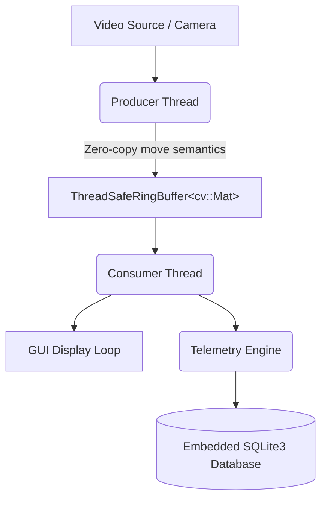

# EdgeStream

EdgeStream is a multithreaded, real-time video ingestion and telemetry engine written in modern C++20. It 
decouples high-throughput video decoding from consumer processing using a custom, bounded thread-safe ring 
buffer, persisting operational pipeline metrics into an embedded SQLite database.


## Architecture Overview

The system implements an asynchronous Producer-Consumer architecture designed to eliminate I/O blocking and 
prevent heap allocation churn during high-frequency frame streaming.



### Core Components

1. **Thread-Safe Ring Buffer (`include/ringBuffer.hpp`)**
   * Header-only template implementation supporting configurable capacity and producer counts.
   * Internal contiguous array storage eliminating dynamic allocations inside the frame ingestion loop.        
   * Synchronization via `std::mutex` and `std::condition_variable` with predicate guards against spurious wakeups.
   * State-aware shutdown protocol (`stop()`) enabling immediate, deadlock-free thread termination.            

2. **Ingestion & Processing Pipeline (`main.cpp`)**
   * **Producer Worker:** Interacts with video backends via OpenCV (`cv::VideoCapture`), pushing frames through move 
   semantics (`std::move`).
   * **Consumer Worker:** Consumes frames, renders display outputs, computes instantaneous throughput metrics, 
   and streams telemetry records.
   * Dual input mode: Supports offline video files or real-time hardware camera streams (`device 0`).          

3. **Embedded Telemetry Layer (`src/database.cpp`, `include/database.hpp`)**
   * Native C++ RAII wrapper encapsulating the SQLite3 C API.
   * Records sequential frame indices, millisecond-precision epoch timestamps, instantaneous queue occupancy, 
   and instantaneous frame rates.
   * Generates summary statistical reports (minimum, maximum, and average values for FPS and queue sizes) upon 
   pipeline termination.


## Empirical Benchmarks & Operational Metrics

The following metrics were observed during empirical pipeline profiling:

| Metric                   | Live Camera Feed (`device 0`) | Prerecorded Video File (`MP4`)               |
|:-------------------------|:------------------------------|:---------------------------------------------|
| **Average Throughput**   | 28.0 - 30.0 FPS               | 29.5 - 31.5 FPS                              |
| **Peak Throughput**      | 33.0 - 34.0 FPS               | 34.0 FPS                                     |
| **Queue Peak Occupancy** | <= 10 frames                  | ~350 frames                                  |
| **Memory Footprint**     | ~220MB (queue capacity = 400) | 645MB (queue capacity = 400, 6MB video file) |
| **Termination Latency**  | < 1 ms upon signal            | < 40 ms upon signal                          |
                                                                                                               
### Telemetry Summary Output Example                                                                           

Upon pipeline completion, the SQLite aggregation engine outputs statistical execution summaries:

```text
Database metrics statistics: Database metrics statistics 
min_time_stamp_ms: 1793982266592
max_time_stamp_ms: 1793982658515
max_queue_size:    348
avg_queue_size:    138.03164556962
max_fps:           33.201733
avg_fps:           28.5504058396624
Pipeline finished successfully.
```


## Verification & Automated Testing

The project includes an automated test suite implemented with GoogleTest (GTest), covering data structure        
invariants, multi-threaded concurrency safety, and database transactional integrity.

### Test Coverage

1. RingBufferTest.InitialStateIsEmpty: Verifies default initialization and queue size reporting.
2. RingBufferTest.MaintainsStrictFIFOOrder: Verifies strict first-in, first-out sequence ordering.
3. RingBufferTest.PopReturnsFalseWhenEmptyAndProducersFinished: Asserts deterministic termination behavior upon 
producer completion.
4. RingBufferConcurrencyTest.StressTestNoDataLossAcrossProducers: Stress-tests 2 concurrent producers (1,000 
total items) against 1 consumer to verify zero race conditions or dropped elements.
5. RingBufferConcurrencyTest.GracefulShutdownUnblocksConsumer: Asserts that stop() wakes sleeping consumer 
threads in under 100 milliseconds without deadlock.
6. DatabaseTest.TableCreationAndInsertReturnsSuccess: Tests schema initialization and parameter binding.
7. DatabaseTest.AggregateMetricsCalculationRunsCleanly: Validates SQL aggregation functions across persisted telemetry 
rows.

All unit and integration tests execute with zero failures.


## Build and Installation

### Prerequisites

- Linux OS (Ubuntu 22.04 / 24.04 recommended)
- C++20 compliant compiler (GCC 12+ or Clang 15+)
- CMake >= 3.22
- OpenCV >= 4.5
- SQLite3 development headers (libsqlite3-dev)

### Compilation

Clone the repository and build the Release configuration:

```shell
mkdir -p build && cd build
cmake -DCMAKE_BUILD_TYPE=Release ..
make -j$(nproc)
 ```

### Running the Test Suite

Execute the GoogleTest binary:

```shell
./run_tests
 ```

### Running the Application

Run the pipeline using a prerecorded video file:

```shell
./main path/to/video.mp4
```

Or execute against a live camera input:
```shell
./main 0
```